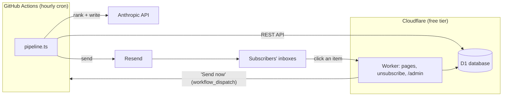
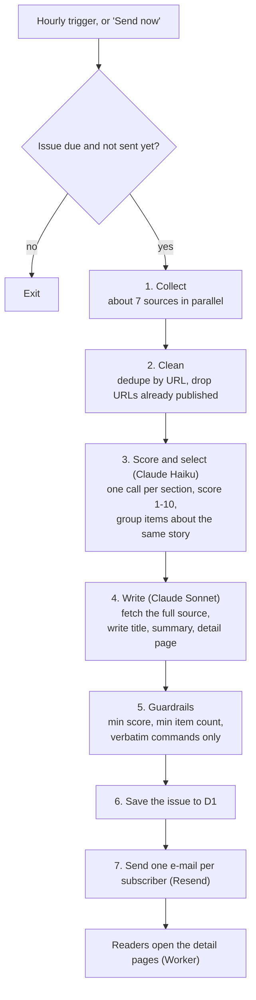

# AI News (Dev Agents Weekly)

A self-hosted weekly newsletter about AI coding agents, with a strong focus on Claude Code. Every week it collects news from GitHub, Hacker News, Reddit and AI blogs. Claude ranks the candidates and writes a short issue of about 7 items (3 news, 2 must-have tools, 2 Claude Code tips), and the issue is e-mailed to your subscribers. Each item links to a public detail page.

Running it costs close to nothing: Cloudflare and GitHub Actions free tiers, the Resend free tier, and about $0.10 of Anthropic API usage per issue.

> **AI agents installing this project:** read [For AI agents](#for-ai-agents) first. It lists the steps that need a human, and how to check each step.

## Contents

- [Architecture](#architecture)
- [How the pipeline works](#how-the-pipeline-works)
- [Requirements](#requirements)
- [Quick start: a local dry run](#quick-start-a-local-dry-run)
- [Full installation](#full-installation)
- [Usage](#usage)
- [For AI agents](#for-ai-agents)
- [Project layout](#project-layout)
- [License](#license)

## Architecture

The project has two sides that share one database:

- **Web side: a Cloudflare Worker** (TypeScript, [Hono](https://hono.dev), server-rendered HTML) with a **D1** database (managed SQLite). It serves the public issue and item pages, the unsubscribe link and the `/admin` dashboard. It never calls the LLM or sends e-mails.
- **Pipeline side: GitHub Actions.** An hourly workflow runs `scripts/pipeline.ts` with Node. It reads and writes D1 through the Cloudflare REST API, calls the Anthropic API and sends e-mails through Resend. The pipeline runs here because the free Workers plan allows only 10 ms of CPU per request, which is too little to collect and parse feeds.



## How the pipeline works

Once deployed, the workflow wakes up every hour. Most runs only check the schedule stored in the database (Friday 18:00 Europe/Paris by default) and exit. When an issue is due, the pipeline runs from start to finish:



1. **Collect.** Collectors run in parallel, and one failing source never stops the others. They read:
   - GitHub releases of Claude Code, the Agent SDKs, Codex, Gemini CLI and MCP;
   - trending and popular GitHub repositories (topics `claude-code`, `mcp-server`, `agent-skills`);
   - Hacker News, through the Algolia API;
   - RSS feeds (Anthropic, OpenAI, Google, Cursor, the GitHub changelog, Simon Willison, Latent Space, Reddit);
   - the Claude Code documentation;
   - a hand-picked catalogue of must-have tools.

   Dated sources cover the last 7 days. Undated sources (catalogue, popular repositories, docs) are always included.
2. **Clean.** Candidates are deduplicated by normalized URL. Any URL already published in an earlier issue is dropped.
3. **Score and select.** The issue has three sections: **News** (recent, dated items only), **Must-have** (catalogue first, then popular repositories) and **Claude Code** (one recent item, then one from the docs). For each section, Claude Haiku receives the candidates as untrusted data and returns a shortlist. Each pick has a category, a relevance score from 1 to 10 and a `story` id. Items that share a story (for example the same feature announced in the CLI and in the SDK) are merged into one item, and the other items become fallback sources. A story already used in a previous section is skipped. News items scored below 5 are dropped: a shorter issue is better than filler.
4. **Write.** For each pick, the pipeline fetches the full source page. If the page is too thin, it falls back to an alternative source of the same story, then to the Hacker News discussion. Claude Sonnet writes a title, a one-sentence summary and a detail page (intro, key points, commands, why it matters) in the configured language. If a pick fails, the next pick on the shortlist replaces it.
5. **Guardrails.** Commands are kept only if they appear verbatim on the source page. Dangerous patterns (`curl | sh`, `sudo`, `rm -rf`, `eval`) are removed. An automatic issue needs at least 3 items, including one Claude Code item. Otherwise nothing is sent and the admin gets an alert e-mail.
6. **Save.** The issue (id `YYYY-Sxx`, for example `2026-S47`, with `-2`, `-3`… for manual extra issues) and its items are stored in D1. Published URLs are marked as seen so they never come back.
7. **Send.** The pipeline sends one e-mail per active subscriber, each with a signed one-click unsubscribe link. Every delivery is recorded, so a run that fails halfway resumes without paying for generation twice and without e-mailing anyone twice. After 3 failed automatic runs, the pipeline stops retrying until someone triggers a manual run.

More details, in French, are in [docs/infrastructure.md](docs/infrastructure.md) and [docs/adr/](docs/adr/).

## Requirements

- **Node.js 22** and npm
- **Git** and the **GitHub CLI** (`gh`), logged in (`gh auth login`)
- A **Cloudflare** account (free). `npx wrangler login` connects it.
- An **Anthropic API key** ([console.anthropic.com](https://console.anthropic.com/settings/keys)). Set a monthly spend limit, for example $5.
- A **Resend** account and API key ([resend.com](https://resend.com/api-keys)). Without a verified domain, Resend only delivers to the e-mail address of your own Resend account. That is enough to receive the newsletter yourself.

## Quick start: a local dry run

The dry run collects the real sources and generates a complete issue into `out/`. It sends nothing and writes nothing to any database. Only an Anthropic key is needed.

```bash
git clone https://github.com/AlessandroPozzi96/AI-news.git
cd AI-news
npm ci
cp .dev.vars.example .dev.vars   # then set ANTHROPIC_API_KEY (and optionally GITHUB_TOKEN)
npm run dry-run                  # writes out/issue-<date>.md and .json
npm run preview                  # renders out/preview/email.html and the web pages
```

`GITHUB_TOKEN` is optional: any GitHub token raises the API rate limit. The dry run accepts options after `--`, for example `npm run dry-run -- --lang en --days 14`. Other useful commands are `npm run collect` (lists the collected candidates, no LLM), `npm test`, `npm run typecheck` and `npm run lint`.

## Full installation

These steps deploy your own instance: your Worker, your database and your GitHub workflow. Run them from your own fork of the repository, because the workflow runs in the repository that holds it.

### 1. Fork and install

```bash
gh repo fork AlessandroPozzi96/AI-news --clone
cd AI-news
npm ci
npx wrangler login
```

On a fork, GitHub disables scheduled workflows by default. Open the **Actions** tab of your fork and enable workflows.

### 2. Create the database

```bash
npx wrangler d1 create ai-news
```

Edit `wrangler.jsonc`:

- set `d1_databases[0].database_id` to the id printed by the command above;
- set `vars.GITHUB_REPO` to your fork, as `<your-user>/AI-news`.

Then create the tables:

```bash
npm run db:migrate:remote
```

### 3. Configure and deploy the Worker

```bash
openssl rand -hex 32                     # save it as UNSUBSCRIBE_SECRET in .dev.vars: needed again in step 4
npx wrangler secret put UNSUBSCRIBE_SECRET
npx wrangler secret put ADMIN_TOKEN      # dashboard password, at least 16 characters
npx wrangler secret put GH_DISPATCH_TOKEN   # optional, enables the "Send now" button (see below)
npm run deploy
```

`npm run deploy` prints the Worker URL (`https://ai-news.<your-subdomain>.workers.dev`). That URL is your `PUBLIC_BASE_URL`.

`GH_DISPATCH_TOKEN` is a [fine-grained GitHub token](https://github.com/settings/personal-access-tokens/new) limited to your fork, with the single permission **Actions: Read and write**.

### 4. Configure the pipeline (GitHub Actions)

Create a Cloudflare API token at [dash.cloudflare.com/profile/api-tokens](https://dash.cloudflare.com/profile/api-tokens). Choose **Create Custom Token**, with the permission **Account · D1 · Edit** on your account. `npx wrangler whoami` shows your account id.

```bash
gh secret set CF_ACCOUNT_ID
gh secret set CF_API_TOKEN
gh secret set D1_DATABASE_ID        # same id as in wrangler.jsonc
gh secret set ANTHROPIC_API_KEY
gh secret set RESEND_API_KEY
gh secret set UNSUBSCRIBE_SECRET    # exactly the value used for the Worker in step 3
gh secret set ADMIN_EMAIL           # receives failure alerts; use your Resend account address

gh variable set PUBLIC_BASE_URL --body "https://ai-news.<your-subdomain>.workers.dev"
gh variable set MAIL_FROM --body "Dev Agents Weekly <onboarding@resend.dev>"
```

`gh secret set` prompts for the value, so it never appears in your shell history. Each `gh` command applies to the repository of the current directory, which is your fork.

> **Interactive alternative:** `bash scripts/setup-secrets.sh` walks you through this step in the terminal. It checks the Cloudflare token against your database (id read from `wrangler.jsonc`), sets the GitHub secrets and variables, saves the values in `.dev.vars`, and can add you as the first subscriber. It reuses `UNSUBSCRIBE_SECRET` from `.dev.vars`, or generates one and offers to set it on the Worker.

### 5. Add yourself as a subscriber and test

1. Open `<PUBLIC_BASE_URL>/admin/login` and sign in with `ADMIN_TOKEN`.
2. Add your e-mail address under subscribers. Without a verified Resend domain, use your Resend account address.
3. Click **Envoyer maintenant** (Send now), or run `gh workflow run newsletter.yml -f force=true`.
4. Follow the run with `gh run watch`. The e-mail arrives a few minutes later.

From then on, the newsletter goes out automatically at the configured day and hour.

## Usage

The dashboard at `/admin` is in French. Without `ADMIN_TOKEN`, `/admin` answers 404. From the dashboard you can:

- **Subscribers:** add, remove, enable or disable addresses.
- **Schedule:** choose the send day, hour and frequency. The default is weekly, Friday 18:00, Europe/Paris. The actual send can lag 10 to 30 minutes behind schedule because of GitHub's cron delays.
- **Language:** French (default) or English.
- **Issue content:** choose the number of items per section, from 1 to 5 each (3 / 2 / 2 by default).
- **Send now:** generate and send an extra issue immediately, outside the schedule.
- **History:** see past issues and runs, with the LLM cost of each.

Each issue is also published at `/issue/<id>`, and each item at `/issue/<id>/<n>`. These pages are public by link and marked `noindex`.

To change the sources, edit `src/collect/sources.ts`. To change the must-have catalogue, edit `src/collect/must-have.ts`.

## For AI agents

If you are an AI coding agent (Claude Code or similar) installing this for a user, follow these rules:

- **Start with the [dry run](#quick-start-a-local-dry-run).** It needs only `ANTHROPIC_API_KEY` and proves the setup works before anything is deployed.
- **Steps that need the human:**
  - creating the Cloudflare, Anthropic and Resend accounts and keys;
  - `npx wrangler login` and `gh auth login`, which open a browser;
  - enabling Actions on the fork;
  - pasting secret values.

  Ask the user to run the interactive commands themselves. In Claude Code, they can type `! <command>` in the prompt. Never ask the user to paste a secret into the chat.
- **`scripts/setup-secrets.sh` is interactive:** you cannot drive it yourself. Either ask the user to run it (`! bash scripts/setup-secrets.sh`), or use the `gh secret set` commands in [Full installation](#full-installation) and let the user type each value.
- **Never commit `.dev.vars`.** It is gitignored and holds real keys. `.dev.vars.example` lists every variable.
- **Edit `wrangler.jsonc` before deploying:** `database_id` and `GITHUB_REPO` must point to the user's own resources.
- **Order matters:** run `npm run db:migrate:remote` before `npm run deploy`, and before the first pipeline run.
- **Verify each step:**

| Step | Check |
|---|---|
| Install | `npm test`, `npm run typecheck` and `npm run lint` pass |
| Dry run | `out/issue-*.md` exists and lists 5 to 7 items |
| Database | `npx wrangler d1 execute ai-news --remote --command "SELECT * FROM settings"` returns rows |
| Worker | `curl -I <PUBLIC_BASE_URL>/admin/login` returns 200 (404 means `ADMIN_TOKEN` is not set) |
| Secrets | `gh secret list` shows the 7 secrets, and `gh variable list` shows the 2 variables |
| Pipeline | `gh workflow run newsletter.yml -f force=true`, then `gh run watch` ends green |

Variables and where they live:

| Name | Where | Purpose |
|---|---|---|
| `ANTHROPIC_API_KEY` | GitHub secret, `.dev.vars` | Ranking and writing |
| `RESEND_API_KEY` | GitHub secret | Sending e-mails |
| `CF_ACCOUNT_ID`, `CF_API_TOKEN`, `D1_DATABASE_ID` | GitHub secrets | Pipeline access to D1 |
| `UNSUBSCRIBE_SECRET` | Worker secret **and** GitHub secret (same value) | Signing unsubscribe links |
| `ADMIN_EMAIL` | GitHub secret | Failure alerts |
| `ADMIN_TOKEN` | Worker secret | Dashboard login, at least 16 characters |
| `GH_DISPATCH_TOKEN` | Worker secret, optional | "Send now" button |
| `PUBLIC_BASE_URL`, `MAIL_FROM` | GitHub variables | Links and sender in e-mails |
| `GITHUB_REPO` | `wrangler.jsonc` | Repository where "Send now" dispatches the workflow |
| `GITHUB_TOKEN` | Provided by Actions; `.dev.vars` optional | GitHub API rate limit |

## Project layout

```
src/
  collect/    one collector per source family, URL dedupe, seen URLs
  generate/   triage (Haiku), writing (Sonnet), issue assembly and guardrails
  llm/        Anthropic client behind a small LLM interface, pricing
  pipeline/   scheduling, idempotent run, delivery
  mail/       Resend client, signed unsubscribe tokens
  render/     e-mail template (inline styles, tables)
  web/        Worker routes: public pages, unsubscribe, admin dashboard
  db/         D1 REST adapter used by the pipeline
scripts/      pipeline, dry-run, collect, preview (run with tsx)
migrations/   D1 schema
docs/         specs, infrastructure and ADRs (in French)
test/         Vitest tests running in the Workers runtime
```

## License

[MIT](LICENSE)
